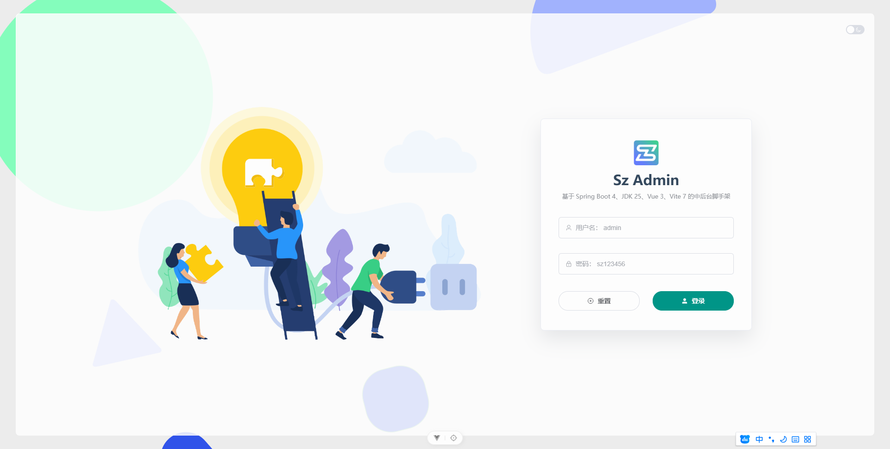

## 12. SzAdmin

官网: https://szadmin.cn/

Sz-Admin 是一套面向企业中后台、管理端系统和二次开发项目的开源脚手架。它希望在常见后台能力、工程结构、权限体系、代码生成、数据库迁移和前后端协作之间取得一个更清晰的平衡：足够轻量，便于理解；足够完整，能够支撑真实项目；足够开放，方便你在自己的业务中继续扩展。

技术主线基于 `Spring Boot 4.x`、`Java 25 LTS`、`Vue 3` 和 `Element Plus`。

项目由后端 `sz-boot-parent` 和前端 `sz-admin` 两个仓库组成：后端提供管理端、生成器、权限、字典、数据权限、资源和 OpenAPI；前端提供登录、动态路由、系统管理页面和代码生成器页面。

### 12.1 开发环境

| 环境    | 推荐版本                        | 说明                                            |
| ------- | ------------------------------- | ----------------------------------------------- |
| Java    | 25 LTS                          | 示例使用 Azul Zulu；当前统一产出 Java 25 字节码 |
| Maven   | 3.8+                            | 推荐 3.9.x                                      |
| 数据库  | MySQL 8.0.17+ 或 PostgreSQL 16+ | 默认使用 MySQL                                  |
| Redis   | 7.x                             | 用于登录态、缓存和同步能力                      |
| Node.js | >= 20.19.0，推荐 20.19.5        | Vite 7 与当前 package.json 的运行要求           |
| pnpm    | 10.17.1                         | 前端包管理工具，建议与 packageManager 保持一致  |

### 12.2 相关链接

| 能力       | 地址                                      |
| ---------- | ----------------------------------------- |
| 后端服务   | http://127.0.0.1:9991/api                 |
| 管理端 API | http://127.0.0.1:9991/api/admin/**        |
| 审计 API   | http://127.0.0.1:9991/api/audit/**        |
| 生成器 API | http://127.0.0.1:9991/api/generator/**    |
| Swagger UI | http://127.0.0.1:9991/api/swagger-ui.html |
| 前端页面   | http://localhost:9848/                    |

### 12.3 后端

后端仓库采用 `sz-common`、`sz-module`、`sz-service` 三层结构。日常本地启动时只需要运行 `sz-service-admin`，它会装配后台管理模块、代码生成器模块、数据库实现、Redis、OpenAPI 和 Liquibase。

#### 12.3.1 源码下载
```shell
mkdir -p examples/SzAdmin/backend
git clone https://gitee.com/feiyuchuixue/sz-boot-parent.git examples/SzAdmin/backend
```

#### 12.3.2 修改配置

| name    | 描述          |
| ------- | ------------- |
| dev     | 开发环境      |
| local   | 本地环境      |
| preview | 预览/测试环境 |
| prod    | 正式环境      |

- 打开项目根目录下的 `config/local` 目录。
- 默认 `DB_TYPE=mysql`，打开 `mysql.yml` 和 `redis.yml` 修改配置。

如使用 `PostgreSQL`，请将 `DB_TYPE` 设置为 `postgresql`，打开 `postgresql.yml` 修改连接信息，并在 `Maven` 中选择 `postgresql` profile。

如果修改`dev`中的`mysql.yml`,`oss.yml`,`redis.yml`, 记得修改`SzAdmin/backend/sz-service/sz-service-admin/src/main/resources/application.yml`中的`spring.profiles.activate`:`dev`

#### 12.3.3 启动

运行 `sz-service/sz-service-admin` 模块中的 `com.sz.AdminApplication.java` 启动文件

出现如下信息,表明程序启动成功
```shell
2026-09-24 10:25:02.746 [main] 40132 [admin-service] [] INFO  c.s.p.l.AppStartListener:26  -  ===================== app is running finish ... =====================
                                   __                _
                                  |  ]              (_)
 .--.   ____  ______  ,--.    .--.| |  _ .--..--.   __   _ .--.
( (`\] [_   ]|______|`'_\ : / /'`\' | [ `.-. .-. | [  | [ `.-. |
 `'.'.  .' /_        // | |,| \__/  |  | | | | | |  | |  | | | |
[\__) )[_____]       \'-;__/ '.__.;__][___||__||__][___][___||__]
------------------https://szadmin.cn | jdk25 | sa-token 1.46.0  (v2.1.0-SNAPSHOT)-------------------
```
验证

访问 http://127.0.0.1:9991/api/swagger-ui.html，能打开 Springdoc 提供的 Swagger UI，即表示接口文档能力可用。也可以访问 http://127.0.0.1:9991/api/actuator/health 检查健康状态。

### 12.4 前端

使用 Vite 7、Vue 3、TypeScript 和 Element Plus。v2.0.0 起接口调用拆分为管理端、审计和生成器三个 HTTP 实例；v2.0.1 起自定义业务模块可通过 VITE_API_CONTEXT_PATH + 模块前缀动态创建 HTTP client。因此本地环境需要同时配置 `VITE_ADMIN_API_BASE`、`VITE_AUDIT_API_BASE`、`VITE_GENERATOR_API_BASE`、`VITE_API_CONTEXT_PATH` 和 `VITE_API_PROXY_TARGET`。

#### 12.4.1 源码下载

```shell
mkdir -p examples/SzAdmin/frontend
git clone https://gitee.com/feiyuchuixue/sz-admin.git examples/SzAdmin/frontend
```

#### 12.4.2 依赖安装

```shell
# 使用 package.json 中锁定的 pnpm 版本
corepack enable
corepack prepare pnpm@10.17.1 --activate

# 如本机未使用 Corepack，也可以全局安装指定版本
npm install -g pnpm@10.17.1

# 进入项目根目录，安装依赖
pnpm install
```

#### 12.4.3 配置本地环境

仓库中已经提供 .env.development，如果只是本地修改后端地址、WebSocket 地址或 clientId，建议在项目根目录创建 .env.development.local，避免覆盖团队共享配置。

```ini
# 本地环境
VITE_USER_NODE_ENV=development

# 公共基础路径
VITE_PUBLIC_PATH=/

# 管理端、审计和生成器接口前缀
VITE_ADMIN_API_BASE=/api/admin
VITE_AUDIT_API_BASE=/api/audit
VITE_GENERATOR_API_BASE=/api/generator
# 自定义模块动态 API 前缀的公共 context-path
VITE_API_CONTEXT_PATH=/api
VITE_API_PROXY_TARGET=http://127.0.0.1:9991

# 授权的 clientId，需要与后端【客户端管理】中的可用客户端一致
VITE_APP_CLIENT_ID=195da9fcce574852b850068771cde034

# 是否对 admin（超管）用户放行前端按钮权限验证，默认放行
VITE_ADMIN_BYPASS_PERMISSION=true

## 启用 WebSocket 连接
## 若需启用 WebSocket，请设置 VITE_SOCKET_URL 为有效的 WebSocket 地址
## 若不设置或留空，WebSocket 功能将不会启用。例：
# VITE_SOCKET_URL=ws://127.0.0.1:9993/socket
```

#### 12.4.4 启动

```shell
pnpm dev

 VITE v7.3.5  ready in 12229 ms

  ➜  Local:   http://localhost:9848/
  ➜  Network: http://172.24.240.1:9848/
  ➜  Network: http://192.168.100.108:9848/
  ➜  Network: http://169.254.2.58:9848/
  ➜  Network: http://172.23.96.1:9848/
  ➜  Vue DevTools: Open http://localhost:9848/__devtools__/ as a separate window
  ➜  Vue DevTools: Press Alt(⌥)+Shift(⇧)+D in App to toggle the Vue DevTools
  ➜  press h + enter to show help
```


