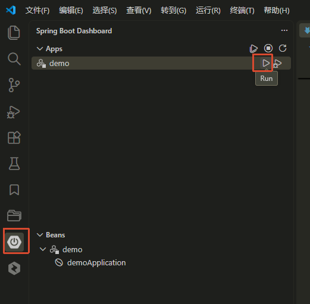
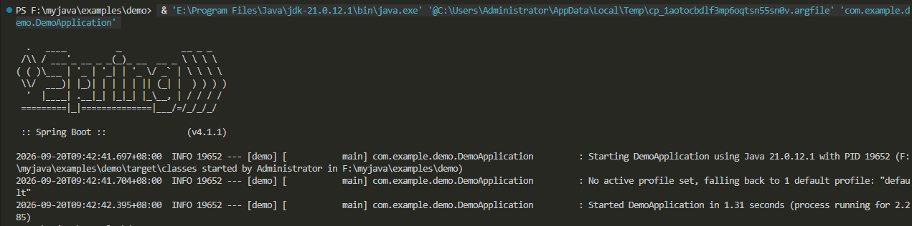

## 4. SpringBoot初始化

### 4.1 创建项目

- vscode选择空目录,右键->创建java项目
- 构建工具选择`Spring Boot`
- 选择`Maven Project`
- 选择SpringBoot版本号`4.1.1`
- 项目id,默认`com.example`
- 实例id,默认`demo`
- 包名称,默认`com.example.demo`
- 构建包类型,选择`jar`
- Java版本选择`21`
- 先不选择依赖 `Selected 0 dependencies`

项目结构:

```
|- demo
|   |- .mvn
|   |- .vscode
|   |- src
|   |   |- main
|   |   |   |- java
|   |   |   |   |- com
|   |   |   |   |   |- example
|   |   |   |   |   |    |- demo
|   |   |   |   |   |    |   |- DemoApplication.java
|   |   |- resources
|   |   |   |- application.properties
|   |   |- test
|   |   |   |- java
|   |   |   |    |- com
|   |   |   |    |    |- example
|   |   |   |    |    |   |- demo
|   |   |   |    |    |   |    |- DemoApplicationTests.java
|   |- .gitattributes
|   |- .gitignore
|   |- HELP.md
|   |- mvnw
|   |- mvnw.cmd
|   |- pom.xml
```

### 4.2 多环境配置

- 将`src/resources/application.properties`改为`src/resources/application.yml`,内容可以清空
- 增加开发环境配置`src/resources/application-dev.yml`
```yml
server:
  servlet:
    context-path: /api
  port: 8080
```
- 增加正式环境配置`src/resources/application-prod.yml`
```yml
server:
  servlet:
    context-path: /api
  port: 9090
```
- 配置`src/resources/application.yml`,设置激活那个配置
```yml
spring:
  profiles:
    active: dev
```


### 4.3 运行项目





### 4.4 修改终端banner(可选)

`resources`目录增加`banner.txt`,输入字体符号图片(可以在这个网站生成[Text to ASCII Art Generator: Create ASCII Art from Text](https://patorjk.com/software/taag/))

例如:

```Text
8888888b.  888    888 8888888b.   .d8888b.    888888        d8888 888     888        d8888
888   Y88b 888    888 888   Y88b d88P  Y88b     "88b       d88888 888     888       d88888
888    888 888    888 888    888        888      888      d88P888 888     888      d88P888
888   d88P 8888888888 888   d88P      .d88P      888     d88P 888 Y88b   d88P     d88P 888
8888888P"  888    888 8888888P"   .od888P"       888    d88P  888  Y88b d88P     d88P  888
888        888    888 888        d88P"           888   d88P   888   Y88o88P     d88P   888
888        888    888 888        888"            88P  d8888888888    Y888P     d8888888888
888        888    888 888        888888888       888 d88P     888     Y8P     d88P     888
:Power by SpringBoot V4.1.1                    .d88P
:JDK 21                                      .d88P"
:Author Huangbh                             888P"
```

### 4.5 解决vscode终端日志中文乱码

`.vscode/settings.json`增加配置,指定编码

```json
"terminal.integrated.defaultProfile.windows": "PowerShell (UTF-8)",
"terminal.integrated.profiles.windows": {
  "PowerShell (UTF-8)": {
    "source": "PowerShell",
    "args": ["-NoExit", "-Command", "chcp 65001 | Out-Null"]
  }
}
```
