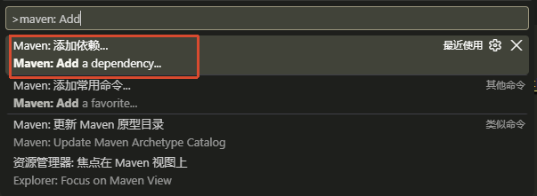
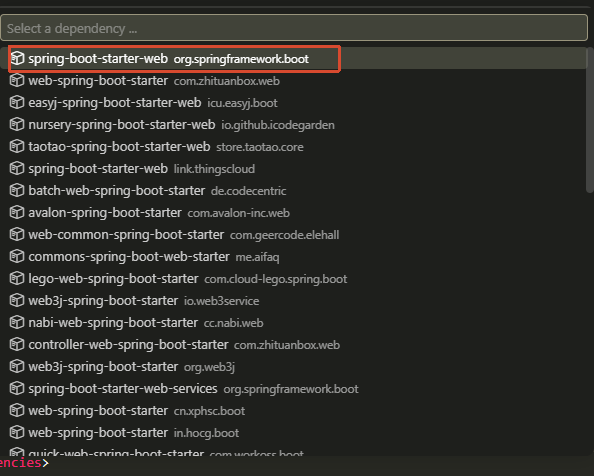
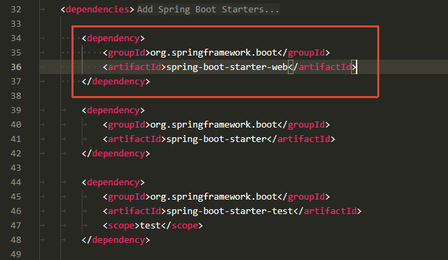
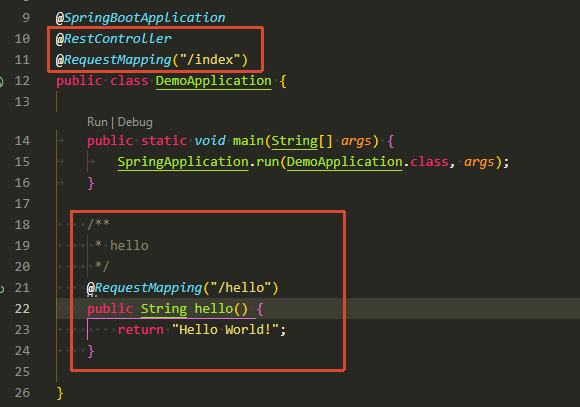
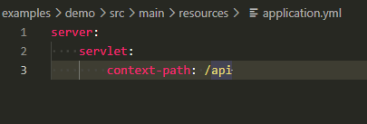
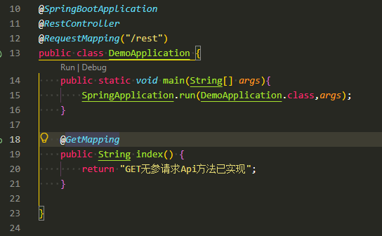
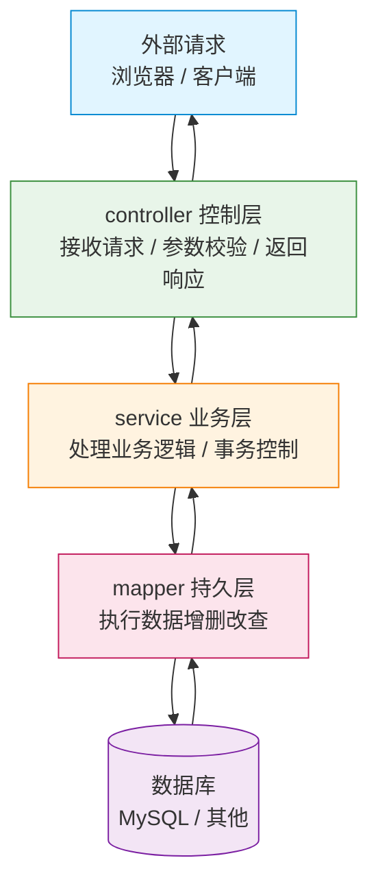

## 5. SprintMVC

### 5.1 安装SprintMVC

- 进入`pom.xml`页面
- 执行`ctrl+alt+p`, 输入`Maven: Add a dependency`
  
- 输入关键词`spring-boot-starter-web`,回车
- 选择`spring-boot-starter-web`进行安装
  
- `pom.xml`的`<dependencies>`标签内将添加`spring-boot-starter-web`依赖,去除`<vension>`标签,版本由父级版本控制器自动管理
  

### 5.2 HelloWorld

- 在`DemoApplication.java`,类添加`@RestController`注解,添加`@RequestMapping("/index")`注解
- 添加`hello`方法,添加`@RequestMapping("/hello")`注解
  
- 运行服务后, 访问`http://localhost:8080/index/hello`,页面打印`Hello World!`

### 5.3 配置

#### 5.3.1 统一访问前缀

- `application.yml`配置`server.servlet.context-path`:`/api`
  
- 重启服务后, 访问`http://localhost:8080/api/index/hello`,页面打印`Hello World!`

#### 5.3.2 设置访问端口

- `application.yml`配置`server.port: 90`
- 重启服务后, 访问`http://localhost:90/api/index/hello`,页面打印`Hello World!`

#### 5.3.3 配置热重载

- 在`pom.xml`添加`spring-boot-devtools`依赖

```xml
<dependency>
    <groupId>org.springframework.boot</groupId>
    <artifactId>spring-boot-devtools</artifactId>
    <scope>runtime</scope>
    <optional>true</optional>
</dependency>
```

- 开启vscode的自动编译Java
  - 打开vscode设置(`ctrl+,`)
  - 搜索 `java.autobuild.enabled`，确保勾选
  - 搜索 `files.autoSave`，建议设为 `afterDelay` 或 `onFocusChange`，避免手动保存遗漏

- `application.yml` 配置开启热重载

```yml
spring:
  devtools:
    restart:
      # 开启热重载（默认就是 true，显式写出更清晰）
      enabled: true
      # 排除不需要触发重启的路径
      exclude: static/**,public/**,templates/**
      # 指定需要额外监控的路径（默认只监控 classpath）
      additional-paths: src/main/java
      # 触发重启前等待的轮询间隔（毫秒），默认 1000
      poll-interval: 1000
      # 静默期，单位毫秒，默认 400，避免连续保存时频繁重启
      quiet-period: 400
    # 关闭 livereload（如果不用浏览器自动刷新可关掉）
    livereload:
      enabled: false
```

### 5.4 Restfull Api实现

#### 5.4.1 Get无参请求

- `DemoApplication.java` 类注解改为`@RequestMapping("/rest")`
- 添加`index`方法,注解为`@GetMapping`,没配置路径,直接用类的`/rest`路径
  


请求测试:
```shell
curl -X GET "http://localhost:90/api/rest"
#响应
GET无参请求Api方法已实现!
```

#### 5.4.2 Get路径传参

```java
    @GetMapping("/{id}")
    public String index(@PathVariable Long id) {
        System.out.printf("ID:%s\n",id);
        return "GET路径传参[PathVariable]请求,ID="+id;
    }
```
请求测试:
```shell
curl -X GET "http://localhost:90/api/rest/11"
#响应
GET路径传参[PathVariable]请求,ID=11
```

#### 5.4.3 Get传参

```java
    @GetMapping
    public String index2(@RequestParam Long id,@RequestParam String name) {
        System.out.printf("ID:%d,Name:%s\n",id,name);
        return "GET传参[RequestParam],ID="+id+",Name="+name;
    }
```

> 注意: 同一个请求Mapping只能有一个,因此需要注释或删除5.4.1的index方法,否则会报错


请求测试:
```shell
curl -X GET "http://localhost:90/api/rest?id=11&name=john"
#响应
GET传参[RequestParam],ID=11,Name=john
```

#### 5.4.4 Post请求

```java
    @PostMapping
    public String save(@RequestBody Map<String,Object> map) {
        System.out.printf(map.toString());
        return "Post请求成功,传参:"+map.toString();
    }
```

请求测试:
```shell
curl -X POST "http://localhost:90/api/rest" -H "content-type:application/json" -d '{"id":11,"name":"john"}'
# 响应
Post请求成功,传参:{id=11, name=john}
```

#### 5.4.5 Put请求

```java
    @PutMapping("/{id}")
    public String putMethodName(@PathVariable Long id, @RequestBody Map<String,Object> map) {
        System.out.printf("ID=%d, data=%s\n", id,map.toString());
        return "Put请求成功,ID="+id+",传参:"+map.toString();
    }
```
请求测试:
```shell
curl -X PUT "http://localhost:90/api/rest/11" -H "content-type:application/json" -d '{"name":"john","age":25}'
# 响应
Put请求成功,ID=11,传参:{name=john, age=25}
```

#### 5.5.6 Delete请求

```java
    @DeleteMapping("/{id}")
    public String delete(@PathVariable Long id) {
        System.out.printf("DELETE ID=%d\n",id);
        return "Detele 请求成功,ID="+id;
    }
```
请求测试:
```shell
curl -X DELETE "http://localhost:90/api/rest/11"
# 响应
Delete请求成功,ID=11
```

### 5.5 三层架构

#### 5.5.1 请求处理流程图

外部请求进入系统后，依次经过控制层、业务层、持久层，最终访问数据库；响应数据则沿原路逐层返回。



#### 5.5.2 各层职责说明

| 层级   | 目录         | 主要职责                                           | 依赖方向     |
| ------ | ------------ | -------------------------------------------------- | ------------ |
| 控制层 | `controller` | 接收 HTTP 请求，校验参数，调用业务层，封装返回结果 | 依赖 service |
| 业务层 | `service`    | 实现核心业务逻辑，控制事务，编排数据操作           | 依赖 mapper  |
| 持久层 | `mapper`     | 与数据库交互，完成数据的增删改查                   | 依赖数据库   |

#### 5.5.3 实现

- 创建控制层目录`demo/src/main/java/com/example/demo/controller`
- 创建业务层目录`demo/src/main/java/com/example/demo/service`
- 创建持久层目录`demo/src/main/java/com/example/demo/mapper`
