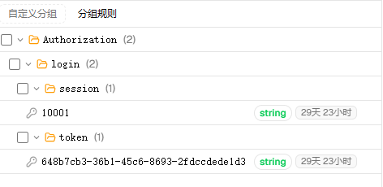

## 9. SaToken

官网文档: https://sa-token.com/readme.html

### 9.1 引入依赖

```xml
<!-- Sa-Token 权限认证，在线文档：https://sa-token.com -->
<dependency>
  <groupId>cn.dev33</groupId>
  <artifactId>sa-token-spring-boot4-starter</artifactId>
  <version>1.46.0</version>
</dependency>
```

### 9.2 配置

```yml
############## Sa-Token 配置 (文档: https://sa-token.com) ##############
sa-token:
  # token 名称（同时也是 cookie 名称）
  token-name: Authorization
    # token 有效期（单位：秒） 默认30天，-1 代表永久有效
  timeout: 2592000
    # token 最低活跃频率（单位：秒），如果 token 超过此时间没有访问系统就会被冻结，默认-1 代表不限制，永不冻结
  active-timeout: -1
    # 是否允许同一账号多地同时登录 （为 true 时允许一起登录, 为 false 时新登录挤掉旧登录）
  is-concurrent: true
    # 在多人登录同一账号时，是否共用一个 token （为 true 时所有登录共用一个 token, 为 false 时每次登录新建一个 token）
  is-share: false
    # token 风格（默认可取值：uuid、simple-uuid、random-32、random-64、random-128、tik）
  token-style: uuid
    # 是否输出操作日志
  is-log: true
```

### 9.3 入口打印配置

`demo/src/main/java/com/example/demo/DemoApplication.java`

```java
    public static void main(String[] args){
        SpringApplication.run(DemoApplication.class,args);
        System.out.println("启动成功,Sa-Token配置如下:"+SaManager.getConfig());
    }
```

### 9.4 测试

`demo/src/main/java/com/example/demo/controller/UserController.java`

默认前后端不分离项目, token存在cookie

```java
    // 测试登录，浏览器访问： http://localhost:8080/api/user/doLogin?username=zhang&password=123456
	@RequestMapping("doLogin")
	public String doLogin(String username, String password) {
		// 此处仅作模拟示例，真实项目需要从数据库中查询数据进行比对
		if("zhang".equals(username) && "123456".equals(password)) {
			StpUtil.login(10001);
			return "登录成功";
		}
		return "登录失败";
	}

	// 查询登录状态，浏览器访问： http://localhost:8081/user/isLogin
	@RequestMapping("isLogin")
	public String isLogin() {
		return "当前会话是否登录：" + StpUtil.isLogin();
	}
```

```shell
# 登录请求
curl -i "http://localhost:8080/api/user/doLogin?username=zhang&password=123456"
# 响应
HTTP/1.1 200
Set-Cookie: Authorization=d7e06e2d-9a99-434e-b314-124879e0c374; Max-Age=2592000; Expires=Wed, 21 Oct 2026 15:50:30 +0800; Path=/
Content-Type: text/plain;charset=UTF-8
Content-Length: 12
Date: Mon, 21 Sep 2026 07:50:30 GMT

登录成功

# 验证登录状态
curl -b "Authorization=d7e06e2d-9a99-434e-b314-124879e0c374" "http://localhost:8080/api/user/isLogin"
# 响应
当前会话是否登录：true
```

### 9.5 集成Redis

> 自 v1.46.0 起，sa-token-redis-template / sa-token-redisson 使用了 Redis 6.0+ 的 SET KEEPTTL 特性。若 Redis 服务低于 6.0，会报 ERR syntax error。解决方案见：Q：Redis 6.0 以下版本集成报错

- 引入依赖

```xml
<!-- Sa-Token 整合 RedisTemplate -->
<dependency>
	<groupId>cn.dev33</groupId>
	<artifactId>sa-token-redis-template</artifactId>
	<version>1.46.0</version>
</dependency>
```

- 验证

重启服务,重新登录请求,Redis将有相应token数据


### 9.6 支持跨域

#### 9.6.1 配置类

`demo/src/main/java/com/example/demo/config/CosConfig.java`

```java
package com.example.demo.config;

import org.springframework.context.annotation.Bean;
import org.springframework.context.annotation.Configuration;

import cn.dev33.satoken.fun.strategy.SaCorsHandleFunction;
import cn.dev33.satoken.router.SaHttpMethod;
import cn.dev33.satoken.router.SaRouter;

@Configuration
public class CosConfig {
    /**
     * CORS 跨域处理策略
     */
    @Bean
    public SaCorsHandleFunction corsHandle() {
        return (req, res, sto) -> {
            res.
                    // 允许指定域访问跨域资源
                    setHeader("Access-Control-Allow-Origin", "*")
                    // 允许所有请求方式
                    .setHeader("Access-Control-Allow-Methods", "POST, GET, PUT, OPTIONS, DELETE")
                    // 有效时间
                    .setHeader("Access-Control-Max-Age", "3600")
                    // 允许的header参数
                    .setHeader("Access-Control-Allow-Headers", "*");

            // 如果是预检请求，则立即返回到前端
            SaRouter.match(SaHttpMethod.OPTIONS)
                    .free(r -> System.out.println("--------OPTIONS预检请求，不做处理"))
                    .back();
        };
    }
}
```

#### 9.6.2 登录处理

```java
    @RequestParam("doLogin")
    public Result doLogin() {
        // 第1步，先登录上
        StpUtil.login(10001);
        // 第2步，获取 Token  相关参数
        SaTokenInfo tokenInfo = StpUtil.getTokenInfo();
        // 第3步，返回给前端
        return Result.success(tokenInfo);
    }
```

```shell
curl -i "http://localhost:8080/api/user/doLogin"

HTTP/1.1 200
Access-Control-Allow-Origin: *
Access-Control-Allow-Methods: POST, GET, PUT, OPTIONS, DELETE
Access-Control-Max-Age: 3600
Access-Control-Allow-Headers: *
Set-Cookie: Authorization=9d9430bf-1d4c-480e-921d-7a92cde6ef21; Max-Age=2592000; Expires=Wed, 21 Oct 2026 16:17:01 +0800; Path=/
Content-Type: application/json
Transfer-Encoding: chunked
Date: Mon, 21 Sep 2026 08:17:01 GMT

{"code":200,"data":{"isLogin":true,"loginDeviceType":"DEF","loginId":"10001","loginType":"login","sessionTimeout":2592000,"tag":null,"tokenActiveTimeout":-1,"tokenName":"Authorization","tokenSessionTimeout":-2,"tokenTimeout":2592000,"tokenValue":"9d9430bf-1d4c-480e-921d-
7a92cde6ef21"},"msg":"操作成功"}
```

### 9.7 全局过滤器

参考: https://sa-token.com/up/global-filter.html

#### 9.7.1 引用依赖

引用常用操作工具类 [Hutool](https://doc.hutool.cn/pages/ai/)

```xml
<dependency>
    <groupId>cn.hutool</groupId>
    <artifactId>hutool-all</artifactId>
    <version>5.8.36</version>
</dependency>
```

#### 9.7.2 配置类

`demo/src/main/java/com/example/demo/config/SaTokenConfig.java`

```java
package com.example.demo.config;

import org.springframework.context.annotation.Bean;
import org.springframework.context.annotation.Configuration;

import com.example.demo.common.Result;

import cn.dev33.satoken.context.SaHolder;
import cn.dev33.satoken.filter.SaServletFilter;
import cn.dev33.satoken.router.SaRouter;
import cn.dev33.satoken.stp.StpUtil;
import cn.dev33.satoken.util.SaResult;
import cn.hutool.json.JSONUtil;

@Configuration
public class SaTokenConfig {
	/**
	 * 注册 [Sa-Token全局过滤器]
	 */
	@Bean
	public SaServletFilter getSaServletFilter() {
        return new SaServletFilter()

        		// 指定 拦截路由 与 放行路由
        		.addInclude("/**").addExclude("/favicon.ico")    /* 排除掉 /favicon.ico */

        		// 认证函数: 每次请求执行
        		.setAuth(obj -> {
					System.out.println("---------- 进入Sa-Token全局认证 -----------");

					// 登录认证 -- 拦截所有路由，并排除/user/doLogin 用于开放登录
					SaRouter.match("/**", "/user/doLogin", () -> StpUtil.checkLogin());

					// 更多拦截处理方式，请参考“路由拦截式鉴权”章节 */
        		})

        		// 异常处理函数：每次认证函数发生异常时执行此函数
        		.setError(e -> {
					// 设置响应头
                    SaHolder.getResponse().setHeader("Content-Type", "application/json;charset=UTF-8");
                    // 使用封装的 JSON 工具类转换数据格式
                    return JSONUtil.toJsonStr( Result.error(e.getMessage()) );
        		})

        		// 前置函数：在每次认证函数之前执行（BeforeAuth 不受 includeList 与 excludeList 的限制，所有请求都会进入）
        		.setBeforeAuth(r -> {
        			// ---------- 设置一些安全响应头 ----------
        			SaHolder.getResponse()
        			// 服务器名称
        			.setServer("sa-server")
        			// 是否可以在iframe显示视图： DENY=不可以 | SAMEORIGIN=同域下可以 | ALLOW-FROM uri=指定域名下可以
        			.setHeader("X-Frame-Options", "SAMEORIGIN")
        			// 是否启用浏览器默认XSS防护： 0=禁用 | 1=启用 | 1; mode=block 启用, 并在检查到XSS攻击时，停止渲染页面
        			.setHeader("X-XSS-Protection", "1; mode=block")
        			// 禁用浏览器内容嗅探
        			.setHeader("X-Content-Type-Options", "nosniff")
        			;
        		})
        		;
	}

}

```

#### 9.7.3 测试

```shell
curl "http://localhost:8080/api/user"
{"code":400,"msg":"操作失败","data":"未能读取到有效 token"}

curl "http://localhost:8080/api/user/doLogin"
{"code":200,"data":{"isLogin":true,"loginDeviceType":"DEF","loginId":"10001","loginType":"login","sessionTimeout":2592000,"tag":null,"tokenActiveTimeout":-1,"tokenName":"Authorization","tokenSessionTimeout":-2,"tokenTimeout":2592000,"tokenValue":"c67a38ca-de4f-4591-90fc-
dc606c22cbfa"},"msg":"操作成功"}

curl -b "Authorization=c67a38ca-de4f-4591-90fc-dc606c22cbfa" "http://localhost:8080/api/user"
{"code":200,"data":[{"age":18,"createTime":null,"email":"test1@baomidou.com","id":1,"name":"Jone","updateTime":null},{"age":20,"createTime":null,"email":"test2@baomidou.com","id":2,"name":"Jack","updateTime":null},{"age":28,"createTime":null,"email":"test3@baomidou.com",
"id":3,"name":"Tom","updateTime":null},{"age":21,"createTime":null,"email":"test4@baomidou.com","id":4,"name":"Sandy","updateTime":null},{"age":24,"createTime":null,"email":"test5@baomidou.com","id":5,"name":"Billie","updateTime":null},{"age":33,"createTime":"2026-09-264
 08:53:48","email":"2377799@163.com","id":6,"name":"LongAoTian","updateTime":"2026-09-264 08:54:03"}],"msg":"操作成功"}
```


### 9.8 注解鉴权

参考: https://sa-token.com/use/at-check.html

### 9.8.1 权限认证

`demo/src/main/java/com/example/demo/service/impl/StpInterfaceImpl.java`

```java
package com.example.demo.service.impl;

import java.util.ArrayList;

import org.springframework.stereotype.Component;

import cn.dev33.satoken.stp.StpInterface;

@Component
public class StpInterfaceImpl implements StpInterface {
    /**
     * 返回一个账号所拥有的权限码集合
     */
    @Override
    public List<String> getPermissionList(Object loginId, String loginType) {
        List<String> list = new ArrayList<>();
        list.add("101");
        list.add("user.add");
        list.add("user.update");
        list.add("user.get");
        // list.add("user.delete");
        list.add("art.*");
        return list;
    }

    /**
     * 获取一个账号所拥有的角色标识集合
     */
    @Override
    public List<String> getRoleList(Object loginId, String loginType) {
        List<String> list = new ArrayList<>();
        list.add("admin");
        list.add("super.admin");
        return list;
    }
}

```

### 9.8.2 权限标识注解

```java
    /**
     * 查询所有用户
     */
    @GetMapping
    @SaCheckPermission("user.list")
    public Result list() {
        return Result.success(userService.list());
    }
```

### 9.8.3 拦截器

- `SaTokenConfig implements WebMvcConfigurer`
- 拦截器

```java
    // 注册 Sa-Token 拦截器，打开注解式鉴权功能
	@Override
	public void addInterceptors(InterceptorRegistry registry) {
		// 注册 Sa-Token 拦截器，打开注解式鉴权功能
		registry.addInterceptor(new SaInterceptor()).addPathPatterns("/**");
	}
```

- 最终效果

```java
package com.example.demo.config;

import org.springframework.context.annotation.Bean;
import org.springframework.context.annotation.Configuration;
import org.springframework.web.servlet.config.annotation.InterceptorRegistry;
import org.springframework.web.servlet.config.annotation.WebMvcConfigurer;

import com.example.demo.common.Result;

import cn.dev33.satoken.context.SaHolder;
import cn.dev33.satoken.filter.SaServletFilter;
import cn.dev33.satoken.interceptor.SaInterceptor;
import cn.dev33.satoken.router.SaRouter;
import cn.dev33.satoken.stp.StpUtil;
import cn.hutool.json.JSONUtil;

@Configuration
public class SaTokenConfig implements WebMvcConfigurer {
	/**
	 * 注册 [Sa-Token全局过滤器]
	 */
	@Bean
	public SaServletFilter getSaServletFilter() {
        return new SaServletFilter()

        		// 指定 拦截路由 与 放行路由
        		.addInclude("/**").addExclude("/favicon.ico")    /* 排除掉 /favicon.ico */

        		// 认证函数: 每次请求执行
        		.setAuth(obj -> {
					System.out.println("---------- 进入Sa-Token全局认证 -----------");

					// 登录认证 -- 拦截所有路由，并排除/user/doLogin 用于开放登录
					SaRouter.match("/**", "/user/doLogin", () -> StpUtil.checkLogin());

					// 更多拦截处理方式，请参考“路由拦截式鉴权”章节 */
        		})

        		// 异常处理函数：每次认证函数发生异常时执行此函数
        		.setError(e -> {
					// 设置响应头
                    SaHolder.getResponse().setHeader("Content-Type", "application/json;charset=UTF-8");
                    // 使用封装的 JSON 工具类转换数据格式
                    return JSONUtil.toJsonStr( Result.error(e.getMessage()) );
        		})

        		// 前置函数：在每次认证函数之前执行（BeforeAuth 不受 includeList 与 excludeList 的限制，所有请求都会进入）
        		.setBeforeAuth(r -> {
        			// ---------- 设置一些安全响应头 ----------
        			SaHolder.getResponse()
        			// 服务器名称
        			.setServer("sa-server")
        			// 是否可以在iframe显示视图： DENY=不可以 | SAMEORIGIN=同域下可以 | ALLOW-FROM uri=指定域名下可以
        			.setHeader("X-Frame-Options", "SAMEORIGIN")
        			// 是否启用浏览器默认XSS防护： 0=禁用 | 1=启用 | 1; mode=block 启用, 并在检查到XSS攻击时，停止渲染页面
        			.setHeader("X-XSS-Protection", "1; mode=block")
        			// 禁用浏览器内容嗅探
        			.setHeader("X-Content-Type-Options", "nosniff")
        			;
        		})
        		;
	}

    // 注册 Sa-Token 拦截器，打开注解式鉴权功能
	@Override
	public void addInterceptors(InterceptorRegistry registry) {
		// 注册 Sa-Token 拦截器，打开注解式鉴权功能
		registry.addInterceptor(new SaInterceptor()).addPathPatterns("/**");
	}
}
```

### 9.8.4 测试

```shell
curl -b "Authorization=c67a38ca-de4f-4591-90fc-dc606c22cbfa" "http://localhost:8080/api/user"
{"timestamp":"2026-09-22T00:52:44.900Z","status":500,"error":"Internal Server Error","path":"/api/user"}

# 后端报错
[/api] threw exception [Request processing failed: cn.dev33.satoken.exception.NotPermissionException: 无此权限：user.list] with root cause

cn.dev33.satoken.exception.NotPermissionException: 无此权限：user.list
```

### 9.8.5 全局异常拦截

- 创建全局异常处理类`demo/src/main/java/com/example/demo/handler/GlobalExceptionHandler.java`
- 针对`NotPermissionException`写对应的处理方法

```java
package com.example.demo.handler;

import org.springframework.web.bind.annotation.ExceptionHandler;
import org.springframework.web.bind.annotation.RestControllerAdvice;

import com.example.demo.common.Result;

import cn.dev33.satoken.context.SaHolder;
import cn.dev33.satoken.exception.NotPermissionException;

@RestControllerAdvice
public class GlobalExceptionHandler {
    @ExceptionHandler(NotPermissionException.class)
    public Result notPermissionException(NotPermissionException e){
        SaHolder.getResponse().setStatus(403);
        return Result.error(403,e.getMessage());
    }
}
```

- 测试

```shell
curl -i -b "Authorization=c67a38ca-de4f-4591-90fc-dc606c22cbfa" "http://localhost:8080/api/user"
HTTP/1.1 403
Access-Control-Allow-Origin: *
Access-Control-Allow-Methods: POST, GET, PUT, OPTIONS, DELETE
Access-Control-Max-Age: 3600
Access-Control-Allow-Headers: *
Server: sa-server
X-Frame-Options: SAMEORIGIN
X-XSS-Protection: 1; mode=block
X-Content-Type-Options: nosniff
Content-Type: application/json
Transfer-Encoding: chunked
Date: Tue, 22 Sep 2026 01:07:36 GMT

{"code":403,"data":null,"msg":"无此权限：user.list"}
```
